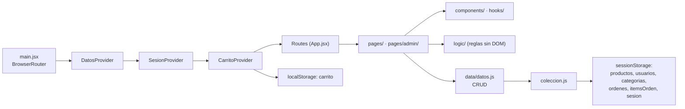
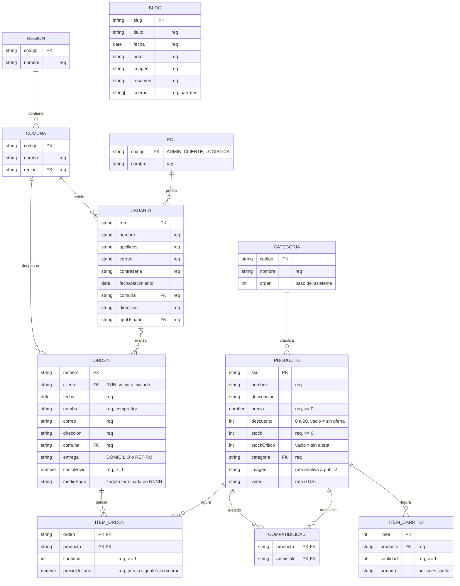
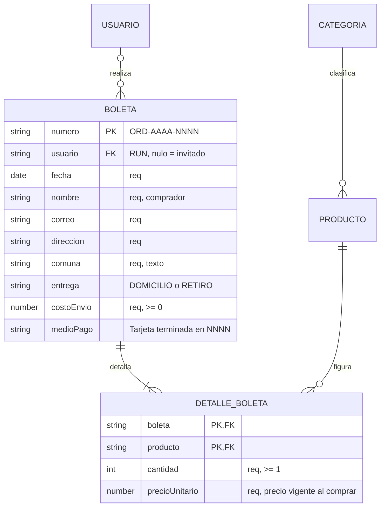

# Ensambla.me

Tienda online de componentes de PC con asistente de armado guiado por compatibilidad.
Frontend React + Vite y, aparte, un backend Spring Boot con MariaDB (sección 11).
Duoc UC · DSY1104 Desarrollo Fullstack II · Entrega II.
ERS rev. 3.1 (29-10-2026), Daniel Muñoz. La versión formal IEEE 830 está en
`ERS - Ensambla.me.docx`.

## Índice

- [1. Ejecución](#1-ejecución)
- [2. Stack y restricciones](#2-stack-y-restricciones)
- [3. Arquitectura](#3-arquitectura)
  - [3.1 Composición de vistas](#31-composición-de-vistas)
  - [3.2 Estado en el cliente](#32-estado-en-el-cliente)
  - [3.3 Roles](#33-roles)
  - [3.4 Capas y carpetas](#34-capas-y-carpetas)
  - [3.5 Componentes](#35-componentes)
  - [3.6 Hooks](#36-hooks)
- [4. Modelo de datos](#4-modelo-de-datos)
- [5. Reglas de validación](#5-reglas-de-validación)
- [6. Requisitos funcionales](#6-requisitos-funcionales)
- [7. Requisitos no funcionales](#7-requisitos-no-funcionales)
- [8. Fuera de alcance](#8-fuera-de-alcance)
- [9. Desviaciones respecto del Anexo 1](#9-desviaciones-respecto-del-anexo-1)
- [10. Pruebas](#10-pruebas)
- [11. Backend (API REST)](#11-backend-api-rest)
- [12. Evaluación 3: pendiente en backend y base de datos](#12-evaluación-3-pendiente-en-backend-y-base-de-datos)

## 1. Ejecución

Requiere Node ≥ 22.22.

```
cd frontend
npm install
npm run dev        # http://localhost:5173/
npm test           # Vitest en modo watch (npm run test:run: una sola pasada)
npm run coverage   # cobertura v8: tabla en consola + coverage/index.html
npm run build      # salida en dist/
npm run lint
```

También se puede servir compilada con Docker, sin tener Node instalado: `docker compose up -d --build`
en `frontend/` (http://localhost:8081). No depende de las otras partes (ver [11.2](#112-cómo-ejecutarlo)).

La aplicación **no usa** el backend de `backend/`: trabaja con datos simulados de `src/data/`.

| Rol                     | Correo             | Contraseña   |
|-------------------------|--------------------|--------------|
| Administrador           | `admin@duoc.cl`    | `admin1234`  |
| Administrador logístico | `bodega@duoc.cl`   | `bodega123`  |
| Cliente                 | `camila@gmail.com` | `cliente123` |

Pago simulado en `/checkout` (no hay cobro real ni se guarda la tarjeta). Tarjetas de prueba:
`4242 4242 4242 4242` aprueba, `4000 0000 0000 0002` la rechaza el emisor y
`4000 0000 0000 9995` por fondos insuficientes; cualquier vencimiento futuro (MM/AA) y CVV de
3 o 4 dígitos. Se puede comprar sin sesión. Cada compra crea una orden con su boleta y descuenta
el stock.

## 2. Stack y restricciones

- React 19 con Vite 8 (JSX), React Router 8 y Bootstrap 5.3.8 por npm, sin CDN.
- Pruebas con Vitest 5, Testing Library y jsdom. Lint con ESLint 10.
- Los datos viven en `src/data/` (semillas y CRUD) y en Web Storage. Sin `fetch()` ni APIs externas.
- Una hoja de estilos propia (`src/styles/style.css`), sin atributos `style=""`.
- HTML semántico y diseño responsivo con la grilla de Bootstrap.
- Navegadores objetivo: Chrome, Firefox y Edge actuales.

## 3. Arquitectura



### 3.1 Composición de vistas

`App.jsx` envuelve las rutas en `DatosProvider` (listas y CRUD, y vuelve a renderizar tras cada
cambio), `SesionProvider` y `CarritoProvider`, de afuera hacia adentro. Las rutas se agrupan en tres
diseños (`components/layout/Layouts.jsx`): tienda con barra lateral de categorías, tienda sin ella y
panel de administración. Las vistas protegidas usan `RutaProtegida`.

```
src/
├── main.jsx, App.jsx
├── pages/            Inicio, Productos, Producto, Categorias, Ofertas, Armado, Carrito,
│   │                 Checkout, PagoCorrecto, PagoError, Perfil, MisCompras, MiCompra,
│   │                 Blogs, Blog, Nosotros, Contacto, Registro, Login, Creditos,
│   │                 NoEncontrada
│   └── admin/        Resumen, Productos, FormularioProducto, Criticos, Categorias,
│                     FormularioCategoria, Usuarios, Usuario, FormularioUsuario,
│                     Ordenes, Orden, Reportes
├── components/       Alerta, Boleta, BotonAgregar, CajaBusqueda, Campo, CampoCorreo,
│   │                 EstadoVacio, FiltrosCatalogo, ImagenProducto, Indicador,
│   │                 ModalConfirmacion, PrecioProducto, RejillaProductos, ResumenPedido,
│   │                 RutaProtegida, SelectRegionComuna, TablaBarras, TablaOrdenes,
│   │                 TarjetaProducto, Toasts
│   └── layout/       Header, Nav, Aside, AsideAdmin, Footer, Layouts
├── context/          datos, sesion, carrito (contexto y hook) + sus *Provider.jsx
├── hooks/            useFormulario, useCriterios, useEliminacion, useTitulo
├── logic/            armado, busqueda, carrito, catalogo, checkout, ordenes, pago,
│                     precios, reportes, stock (reglas puras, sin DOM ni almacenamiento)
├── data/             semillas.js (datos de prueba), coleccion.js, datos.js (CRUD)
├── utils/            formato, recursos, validaciones
├── styles/style.css
└── setupTests.js, testUtils.jsx, *.test.js(x) (junto al archivo que prueban)
public/resources/     img/ (productos/<SKU>.webp, SVG), video/ensamblame.mp4
```

### 3.2 Estado en el cliente

| Almacén          | Clave                                                          | Contenido                                                                                          | Vida                                      |
|------------------|----------------------------------------------------------------|----------------------------------------------------------------------------------------------------|-------------------------------------------|
| `localStorage`   | `carrito`                                                      | JSON `[{linea, producto, cantidad, armado}]` (`armado` es `null` en las sueltas); si es corrupto, se reinicia vacío | Persistente; no se borra al cerrar sesión |
| `sessionStorage` | `sesion`                                                       | RUN, nombre, apellidos, correo y rol                                                               | Hasta el logout o cerrar el navegador     |
| `sessionStorage` | `productos`, `usuarios`, `categorias`, `ordenes`, `itemsOrden` | Copia de trabajo sembrada desde `semillas.js`, donde escribe el CRUD de `datos.js`                 | Sesión del navegador                      |

`coleccion.js` lee la colección en cada consulta y la escribe completa en cada cambio. Si el
contenido no se puede leer, vuelve a la semilla.

### 3.3 Roles

| Rol                     | Acceso                                                                                                                  |
|-------------------------|-------------------------------------------------------------------------------------------------------------------------|
| Cliente                 | Tienda pública, compra con o sin sesión, `/perfil` y `/mis-compras`                                                     |
| Administrador           | Lo anterior y el panel completo: Resumen, Productos, Críticos, Categorías, Usuarios, Órdenes, Reportes y Mi perfil      |
| Administrador logístico | Productos (solo lectura), Críticos, Órdenes (solo lectura) y Mi perfil. El resto del menú no existe en el DOM           |

`RutaProtegida roles={[…]}`: sin sesión redirige a `/login?destino=…`; con un rol no autorizado
muestra «Acceso denegado» y no renderiza la vista. Tras iniciar sesión, el Administrador llega a
`/admin`, el logístico a `/admin/productos` y el cliente a `/`.

### 3.4 Capas y carpetas

```
pages → components    pages → context       context → data
pages / context → logic    pages / components → hooks, utils
```

| Carpeta | Archivos | Objetivo |
|---|---|---|
| `src/` | `main.jsx`, `App.jsx` | Monta React con Bootstrap y el CSS propio; `App` define las rutas con layouts anidados y `RutaProtegida` |
| `context/` | `datos`, `sesion`, `carrito` (+ `*Provider.jsx`) | Datos y CRUD con re-render; sesión en `sessionStorage`; líneas del carrito en `localStorage` |
| `data/` | `coleccion`, `datos`, `semillas`, `creditos` | Colección genérica sobre `sessionStorage`; tablas con CRUD y reglas de integridad; datos iniciales (con los 3 blogs) y de créditos |
| `logic/` | `catalogo`, `busqueda`, `precios`, `stock` | Filtros y orden, búsqueda, precio vigente y stock |
| | `carrito`, `checkout`, `pago` | Líneas, entrega, envío, stock y pasarela simulada |
| | `ordenes`, `reportes`, `armado` | IVA y permisos de órdenes, estadísticas y compatibilidad |
| `utils/` | `validaciones`, `formato`, `recursos` | RUN, correo, contraseña, tarjeta (Luhn); formato de precios y fechas; rutas de imágenes |
| `pages/admin/` | `Resumen`, `Reportes`, `Criticos` | Dashboard, estadísticas por periodo y stock bajo |
| | `Productos`, `Categorias`, `Usuarios` + `Formulario*` | Mantenedores: listado, crear y editar |
| | `Usuario`, `Ordenes`, `Orden` | Ficha con historial, listado de órdenes y boleta |

### 3.5 Componentes

Funciones que reciben `props` y devuelven JSX con clases de Bootstrap.

| Grupo | Componente | Qué hace |
|---|---|---|
| Avisos | `Alerta` (`tipo`) | Aviso con `role="alert"`; `ZonaAviso`, en el mismo archivo, es una zona `aria-live` |
| | `EstadoVacio` | Mensaje cuando no hay nada que mostrar |
| | `Toasts` (`avisos`, `onCerrar`) | Confirmaciones del carrito abajo a la derecha |
| | `ModalConfirmacion` (`abierto`, `titulo`, `onConfirmar`, `onCancelar`) | Diálogo controlado por React, sin JS de Bootstrap. Enfoca «Cancelar»; Escape o clic en el fondo cierran sin confirmar |
| Formularios | `Campo` (`id`, `etiqueta`, `error`, `sugerencia`, `estado`, `como`) | Une etiqueta y control (`for`/`id`), muestra error y sugerencia, pone `aria-invalid`. Base de todos los formularios |
| | `CampoCorreo` | `Campo` de correo con `<datalist>` de dominios permitidos |
| | `SelectRegionComuna` (`formulario`, `prefijo`) | Selects encadenados: al cambiar la región se recargan las comunas |
| | `CajaBusqueda` | Búsqueda de un listado con conteo «Mostrando 3 de 10» en zona `aria-live` |
| | `FiltrosCatalogo` | Búsqueda, categoría, precios, orden y casillas. Texto y precios se aplican al enviar; el resto, al cambiar. Los criterios viven en la URL |
| Producto | `TarjetaProducto` (`producto`, `nivel`) | Imagen, nombre, categoría, precio y botón de añadir |
| | `RejillaProductos` | `row-cols-1 row-cols-sm-2 row-cols-lg-3`; sin productos muestra `EstadoVacio` |
| | `ImagenProducto`, `PrecioProducto`, `BotonAgregar` | Imagen o recuadro vacío; precio vigente con el de lista tachado (0 = «Gratis»); botón que llama a `agregar` y queda «Sin stock» si no hay |
| Compra | `ResumenPedido` | Productos, subtotal, envío («Según la entrega» si es `null`) y total |
| | `Boleta` | Comprobante simulado con IVA 19 % desglosado y botón para imprimir |
| | `TablaOrdenes` | Órdenes de la más reciente a la más antigua, con enlace a cada boleta |
| Panel | `Indicador`, `TablaBarras` | Cifra del resumen; tabla con barra proporcional (el valor siempre va también como texto) |
| Seguridad | `RutaProtegida` (`roles`) | Redirige a `/login` recordando el destino, o muestra «Acceso denegado» |
| `layout/` | `Layouts` | `LayoutTienda` y `LayoutAdmin`, con `<Outlet />` |
| | `Header`, `Nav`, `Aside`, `Footer` | Barra superior (cerrar sesión navega a `/` dentro de una transición); menú `navbar-expand-xl` con búsqueda y carrito; categorías; pie |
| | `AsideAdmin` | Menú del panel: solo renderiza las opciones del rol |

Patrones: composición (`RejillaProductos` → `TarjetaProducto` → `ImagenProducto`, `PrecioProducto`,
`BotonAgregar`), una responsabilidad por componente, casi todos sin estado propio (lo tienen
`FiltrosCatalogo`, `Nav` y `ModalConfirmacion`), estado global por contexto (`useCarrito`,
`useSesion`) y accesibilidad con `role="alert"`, `aria-live`, `aria-invalid` y etiquetas por `id`.

**Punto a mejorar:** `ResumenPedido`, `Boleta` y `TablaOrdenes` importan funciones de
`data/datos.js` en vez de recibir los datos por props o contexto.

### 3.6 Hooks

React: `useState` (valor que redibuja), `useEffect` (efectos fuera del render), `useContext`,
`useMemo`/`useCallback` y `useRef`. Propios, en `src/hooks/`:

| Hook | Qué encapsula |
|---|---|
| `useFormulario` | Valores, errores y validación; lo usan 8 formularios |
| `useCriterios` | Filtros del catálogo sincronizados con la URL |
| `useEliminacion` | Pedir confirmación y eliminar |
| `useTitulo` | Título de la pestaña |

Los hooks de contexto (`useSesion`, `useCarrito`, `useDatos`) están en `src/context/`. Solo se llaman
al nivel superior de un componente o hook (nunca en `if`, bucles ni funciones anidadas); lo revisa
`eslint-plugin-react-hooks`. Un hook se prueba aislado con `renderHook` (`hooks/useFormulario.test.js`).

## 4. Modelo de datos

Nombres de campo idénticos a los de `semillas.js`. `"req"` = obligatorio.



| Datos                                                          | Origen                      | Escritura                                                                |
|----------------------------------------------------------------|-----------------------------|--------------------------------------------------------------------------|
| `compatibilidad`, `regiones`, `comunas`, `roles`, `blogs`      | Constantes de `semillas.js` | Solo lectura                                                             |
| `productos`, `usuarios`, `categorias`, `ordenes`, `itemsOrden` | Semilla en `semillas.js`    | Copia en `sessionStorage` vía `coleccion.js`; el CRUD está en `datos.js` |
| Ítem carrito                                                   | —                           | `localStorage.carrito` (`context/carrito.js`, reglas en `logic/carrito.js`) |

- Las escrituras de `datos.js` aplican las reglas de negocio y devuelven `{ ok, registro, mensaje }`;
  con `ok` en `false` no cambian nada.
- Claves: comuna `RM-02` (región más índice); orden `ORD-2026-0001` (correlativo por año de la
  compra); armado `ARM-<Date.now() en base 36>`; RUN con DV, sin puntos ni guion. Fechas ISO.
- Los precios incluyen IVA (19 %). La orden guarda el precio vigente de cada ítem, porque el del
  producto puede cambiar después.
- Una orden de invitado tiene `cliente` vacío y se ve con su enlace; las de una cuenta las ven su
  dueño y el personal (`logic/ordenes.js: puedeVerOrden`).
- `compatibilidad` se genera con `flatMap` desde `paresDeCompatibilidad` (SKU → SKU admisibles de
  la categoría siguiente). Armado no es una relación: es el valor `armado` que comparten las líneas
  de un grupo.
- No se almacenan derivados (total, subtotal, IVA, precio del armado, región del usuario).
- 3NF, salvo `Blog.cuerpo` (`string[]` por simplicidad; en una base real sería Párrafo).

## 5. Reglas de validación

Es en tiempo real (al escribir y al salir del campo), con el error junto al campo. Al enviar se
validan todos y se enfoca el primero inválido. Cada campo con formato muestra una sugerencia
(`form-text`) antes de cualquier error. Reglas en `utils/validaciones.js`, aplicadas por
`hooks/useFormulario.js`.

| Campo                            | Regla                                                                                      |
|----------------------------------|--------------------------------------------------------------------------------------------|
| RUN                              | Requerido, 7–9 caracteres sin puntos ni guion, DV módulo 11. Válido: `190110222`           |
| Correo                           | Requerido, ≤ 100, dominio `@duoc.cl`, `@profesor.duoc.cl` o `@gmail.com` (con `datalist`)  |
| Contraseña                       | Requerida, 4–10, `type="password"`. Al cambiarla: actual, nueva y repetición; la nueva coincide y difiere de la actual |
| Nombre / apellidos               | Requeridos, ≤ 50 / ≤ 100                                                                   |
| Región → comuna                  | Requeridas; la comuna se filtra por la región                                              |
| Dirección                        | Requerida, ≤ 300                                                                           |
| Fecha de nacimiento              | Opcional                                                                                   |
| Contacto: nombre / comentario    | Requeridos, ≤ 100 / ≤ 500                                                                  |
| SKU                              | Requerido, ≥ 3, único                                                                      |
| Nombre / descripción de producto | Requerido ≤ 100 / opcional ≤ 500                                                           |
| Precio                           | Requerido, ≥ 0, admite decimales; 0 = gratis                                               |
| Descuento                        | Opcional, entero 0–90; vacío o 0 = sin oferta                                              |
| Stock / stock crítico            | Requerido / opcional; enteros ≥ 0                                                          |
| Categoría de producto            | Requerida (select). Imagen y video: opcionales (ruta o URL)                                |
| Código de categoría              | Requerido, 3–30, minúsculas, números y guiones; único. Nombre: requerido, ≤ 50            |
| Tarjeta                          | Requerida, 13–19 dígitos (admite espacios) con Luhn                                        |
| Vencimiento / código             | `MM/AA` no anterior al mes actual / 3 o 4 dígitos, `type="password"`                       |

## 6. Requisitos funcionales

El código cita los criterios como `RF-xx CAn`. RF-16 está retirado y RF-17 a RF-27 son de la
Entrega II. Los archivos van relativos a `src/`.

**RF-01 Registrar usuario** · Cliente · `pages/Registro.jsx`, `utils/validaciones.js`
1. Sin un campo requerido no se envía y se marca cada faltante.
2. `190110222` se acepta; con puntos, guion o DV incorrecto (`19.011.022-3`) da «RUN inválido».
3. Un dominio no permitido (`juan@hotmail.com`) lista los aceptados; contraseña fuera de 4–10 da error.
4. Al cambiar la región se recargan las comunas. No se superan los máximos.
5. Un formulario válido agrega el usuario como Cliente y confirma. RUN o correo repetidos se rechazan.

**RF-02 Iniciar sesión** · todos · `pages/Login.jsx`, `context/SesionProvider.jsx`
1. Con credenciales válidas redirige a `?destino=` (solo rutas del mismo sitio) o según el rol:
   Cliente → tienda; Administrador → panel; Logístico → RF-12.
2. Dominio inválido o contraseña fuera de 4–10 da error. Sin coincidencia: «correo o contraseña
   incorrectos».

**RF-03 Catálogo** · Cliente · `pages/Inicio.jsx`, `pages/Productos.jsx`, `components/RejillaProductos.jsx`, `components/TarjetaProducto.jsx`
Una tarjeta (imagen, nombre, categoría, precio en CLP) por producto, generada desde los datos. Sin
productos aparece un aviso.

**RF-04 Detalle de producto** · Cliente · `pages/Producto.jsx`
Muestra imagen, nombre, precio, descripción, categoría, stock y «Añadir al carrito». Un SKU
inexistente muestra «producto no encontrado». Si hay `video` se embebe; si no, no queda contenedor vacío.

**RF-05 Agregar al carrito** · Cliente · `components/BotonAgregar.jsx`, `context/CarritoProvider.jsx`, `logic/carrito.js`
Invariante: las unidades de un SKU en el carrito (sueltas y armados) nunca superan su `stock`.
1. Añadir suma 1, persiste en `localStorage` y confirma visualmente; un SKU presente incrementa su línea.
2. Con `stock` 0 el botón queda «Sin stock». Si se excede, se rechaza con las unidades disponibles
   (con stock 2, la 3.ª se rechaza).

**RF-06 Gestionar carrito** · Cliente · `pages/Carrito.jsx`, `logic/carrito.js`
1. Cada línea muestra imagen, nombre, precio unitario, cantidad y subtotal; eliminar o cambiar la
   cantidad recalcula el total sin recargar.
2. Mínimo 1; máximo el stock menos las otras líneas del mismo SKU (un valor mayor se ajusta con mensaje).
3. Persiste tras recargar; si el stock bajó, se ajusta y la línea sin unidades se quita.
4. Vacío: mensaje, total 0 y «Ir a pagar» deshabilitado.

**RF-07 Asistente de armado** · Cliente · `pages/Armado.jsx`, `logic/armado.js`, `logic/carrito.js`
Orden: CPU → placa → RAM → almacenamiento → fuente → gabinete → refrigeración → GPU →
periféricos. Modos *completo* y *módulos*. El filtrado sale de la tabla estática `Compatibilidad`.
1. Una categoría a la vez; la siguiente lista solo los admisibles del componente elegido.
2. En módulos se puede finalizar antes; en completo, recorrer todo agrega el conjunto.
3. En el carrito el armado es un grupo con detalle y precio igual a la suma.
4. Un componente sin stock aparece «sin stock» y no se elige; si al finalizar falta stock (RF-05)
   no se agrega y se nombran los faltantes.

**RF-08 Contacto** · Cliente · `pages/Contacto.jsx`
Campos vacíos o dominio no permitido dan error por campo; nombre ≤ 100 y comentario ≤ 500. Un
formulario válido muestra éxito y limpia los campos.

**RF-09 Blogs** · Cliente · `pages/Blogs.jsx`, `pages/Blog.jsx`
Listado con imagen, título y descripción corta; detalle con descripción larga (≥ 2 artículos navegables).

**RF-10 Mantenedor de Productos** · Administrador · `pages/admin/Productos.jsx`, `pages/admin/FormularioProducto.jsx`
1. Listado con crear, editar, eliminar y búsqueda por código, nombre o categoría.
2. Se rechazan SKU < 3 caracteres o repetido, precio < 0, descuento fuera de 0–90 o decimal, stock
   negativo o decimal, y producto sin categoría. El precio admite decimales y 0.
3. Si `stock` ≤ `stockCritico`, el listado alerta. El `video` vacío no bloquea el guardado.
4. Eliminar pide confirmación; las órdenes conservan su detalle y el carrito descarta la línea.

**RF-11 Mantenedor de Usuarios** · Administrador · `pages/admin/Usuarios.jsx`, `pages/admin/Usuario.jsx`, `pages/admin/FormularioUsuario.jsx`
1. Buscar, crear, editar y eliminar, con las validaciones de RF-01; RUN o correo repetidos se rechazan.
2. El select de tipo ofrece Administrador, Cliente y Administrador logístico (no existe en el registro público).
3. La ficha `/admin/usuarios/:run` muestra sus datos, sin contraseña, y su historial con enlace a cada boleta.
4. Eliminar pide confirmación y se rechaza con la cuenta en sesión o con un usuario con órdenes.

**RF-12 Productos, críticos y órdenes en lectura** · Logístico · `pages/admin/Productos.jsx`, `Criticos.jsx`, `Ordenes.jsx`, `Orden.jsx`
Productos sin crear, editar ni eliminar. Órdenes con cliente, fecha, productos y total, búsqueda por
número, cliente, correo o producto, y detalle en solo lectura. Ve los críticos (RF-26) y su perfil (RF-23).

**RF-13 Cerrar sesión** · todos · `components/layout/Header.jsx`, `context/SesionProvider.jsx`
Visible en toda vista con sesión; borra `sessionStorage.sesion` y redirige a la tienda. No borra el
`carrito`: pertenece al navegador, no al usuario.

**RF-14 Navegación** · Cliente · `components/layout/Nav.jsx`, `Aside.jsx`, `Footer.jsx`
Cada enlace del menú (Inicio, Productos, Categorías, Ofertas, Armar mi PC, Blogs, Nosotros, Contacto)
y el logo llevan a su vista. El contador del carrito se actualiza. Cada categoría de la barra lateral
lleva a `/productos?categoria=…` y la búsqueda del menú al catálogo (RF-17).

**RF-15 Nosotros** · Cliente · `pages/Nosotros.jsx`
Describe la empresa y presenta a sus desarrolladores.

**RF-17 Buscar y filtrar el catálogo** · Cliente · `pages/Productos.jsx`, `components/FiltrosCatalogo.jsx`, `hooks/useCriterios.js`, `logic/catalogo.js`, `logic/busqueda.js`
1. La búsqueda ignora mayúsculas y tildes y exige cada palabra en nombre, SKU, descripción o categoría.
2. Filtra por categoría, precio mínimo y máximo (sobre el vigente), solo ofertas y solo con stock;
   ordena por catálogo, precio, nombre o mayor descuento.
3. Los criterios viajan en la URL (`?q=&categoria=&min=&max=&oferta=1&stock=1&orden=`): el enlace se
   comparte, Atrás recupera el filtro y un valor inválido se ignora.
4. Texto y precios se aplican al enviar; el resto, al cambiar. «Limpiar filtros» los borra. Un mínimo
   mayor que el máximo se avisa; sin coincidencias hay un mensaje.

**RF-18 Ofertas y precio vigente** · Cliente · `pages/Ofertas.jsx`, `logic/precios.js`, `components/PrecioProducto.jsx`
1. Un producto con `descuento` > 0 (entero, máx. 90) está en oferta; el vigente es el de lista menos
   el descuento, redondeado a pesos. Carrito, pago, órdenes y reportes usan siempre el vigente.
2. `Ofertas` lista solo las ofertas, de mayor a menor descuento, con los filtros de RF-17; sin ellas
   avisa y enlaza al catálogo.

**RF-19 Productos por categoría** · Cliente · `pages/Categorias.jsx`, `components/layout/Aside.jsx`
Agrupa los productos por categoría (los tres primeros y «Ver los N productos»); una categoría vacía
avisa. `/productos?categoria=…` titula la lista; un código inexistente se ignora.

**RF-20 Pagar la compra** · Cliente · `pages/Checkout.jsx`, `logic/checkout.js`, `components/ResumenPedido.jsx`
1. Carrito vacío: avisa y no muestra el formulario. Se compra sin sesión; con sesión los datos de
   envío se completan y se pueden cambiar.
2. Nombre, apellidos, correo, región, comuna y dirección son requeridos.
3. Entrega a domicilio ($4.990, gratis desde $200.000 en productos) o retiro (gratis); al elegir se
   recalculan envío, total y botón.
4. La tarjeta se valida (Luhn, vencimiento, código) y se agrupa de a cuatro; nunca se guarda. Un
   pedido de $0 no pide tarjeta y el botón dice «Confirmar pedido».
5. Antes de cobrar se revisa el stock; si falta, no se cobra y se nombran los productos.

**RF-21 Confirmar o rechazar el pago** · Cliente · `pages/PagoCorrecto.jsx`, `pages/PagoError.jsx`, `logic/pago.js`
1. Simulado: las tarjetas de la sección 1 aprueban o rechazan; cualquier otro número válido aprueba.
2. Aprobado: se crea la orden (RF-22), se vacía el carrito y `/pago/correcto/:numero` muestra la boleta.
3. Rechazado: `/pago/error` muestra motivo y resumen; no hay cobro y el stock y el carrito no cambian.
   «Reintentar el pago» vuelve al checkout con los datos de envío (sin la tarjeta).
4. La confirmación solo la ve quien puede ver esa orden; si no, «Orden no encontrada».

**RF-22 Registrar la orden y mostrar la boleta** · Cliente, Administrador, Logístico · `data/datos.js (crearOrden)`, `logic/ordenes.js`, `components/Boleta.jsx`
1. Cada compra aprobada crea una orden `ORD-AAAA-NNNN` con comprador, entrega, envío, medio de pago
   y un ítem por producto con su precio vigente, y descuenta el stock. Se valida entera antes de
   escribir: si algo falla no cambia nada.
2. La boleta muestra comprador (RUN o invitado), entrega, pago, detalle, subtotal, envío y total con
   IVA desglosado (neto + 19 %). Es simulada y se puede imprimir.
3. Una orden conserva su detalle aunque el producto se elimine.

**RF-23 Gestionar mi perfil** · todos con sesión · `pages/Perfil.jsx`
1. RUN y tipo no se editan. Se editan nombre, apellidos, correo, fecha de nacimiento, región, comuna
   y dirección con las validaciones de RF-01; un correo de otra cuenta se rechaza.
2. Al guardar, el saludo del encabezado se actualiza. El cambio de contraseña se rechaza si la
   actual es incorrecta, si no coinciden o si la nueva es igual a la actual.
3. Administrador y logístico lo ven en `/admin/perfil`.

**RF-24 Historial de compras** · Cliente · `pages/MisCompras.jsx`, `pages/MiCompra.jsx`, `components/TablaOrdenes.jsx`
`/mis-compras` exige sesión y lista las compras (número, fecha, productos, total), con cantidad y
gasto total; sin compras enlaza al catálogo. `/mis-compras/:numero` muestra la boleta propia; la de
otra cuenta o de un invitado da «Orden no encontrada».

**RF-25 Mantenedor de Categorías** · Administrador · `pages/admin/Categorias.jsx`, `pages/admin/FormularioCategoria.jsx`
1. Listado con código, nombre, paso del asistente y número de productos; crear, editar y eliminar.
2. Código único de 3–30 (minúsculas, números, guiones) que no cambia al editar; nombre ≤ 50.
3. Las nuevas aparecen en catálogo, filtros y ficha, pero no en el asistente.
4. Eliminar pide confirmación y se rechaza si es un paso del asistente o tiene productos.

**RF-26 Productos críticos** · Administrador, Logístico · `pages/admin/Criticos.jsx`, `logic/stock.js`
Lista los de `stock` ≤ `stockCritico`: primero los agotados, luego mayor faltante y por SKU. Cada fila
muestra stock, umbral, faltante y estado. El Administrador repone desde la ficha; el logístico solo lee.

**RF-27 Reportes** · Administrador · `pages/admin/Reportes.jsx`, `logic/reportes.js`
Periodo con fechas inclusivas (rango invertido se avisa). Resume órdenes, ingresos (con IVA), envíos,
unidades y ticket promedio; ventas por mes y categoría; top 5 de productos y de clientes (un
invitado se agrupa por correo); inventario valorizado a precio de lista y productos críticos.

## 7. Requisitos no funcionales

**RNF-01 Rendimiento** · `vite.config.js`, `main.jsx`: cada vista carga en < 2 s con `npm run dev` o
`preview`; el empaquetado pesa 432 kB de JS (125 kB comprimido) y 242 kB de CSS (34 kB). Solo hay
peticiones del mismo origen y cambiar de vista no recarga la página.

**RNF-02 Seguridad** · `components/RutaProtegida.jsx`, `utils/validaciones.js`
1. Una URL de admin sin sesión lleva al login; con rol Cliente o tras el logout se deniega. El
   logístico ve en el menú solo Productos, Críticos, Órdenes y Mi perfil (las demás opciones no
   existen en el DOM) y si abre por URL un formulario de crear o editar se deniega sin renderizarlo.
2. Las contraseñas y el código de la tarjeta usan `type="password"`; un valor inválido da error antes
   de enviar, y RUN, correo y contraseña muestran sugerencia de formato.
3. Tras iniciar sesión solo se respeta un destino del mismo sitio.

**RNF-03 Fiabilidad** · `context/`, `data/coleccion.js`
Sin errores de JS en consola. Un error de validación no impide navegar. Un `carrito`, sesión o
colección corruptos se descartan (vacío, sin sesión y semilla). Si el almacenamiento está bloqueado
o lleno, el error queda en consola y la aplicación sigue usable.

**RNF-04 Disponibilidad** · hosting: sitio accesible por su URL pública sin credenciales.

**RNF-05 Mantenibilidad** · `components/`, `hooks/`, `logic/`, `eslint.config.js`
1. Un componente, una responsabilidad, con datos por props; reglas de negocio en `logic/` y `utils/`.
2. Una única hoja propia sin `style=""`; un cambio en encabezado, menú o pie se hace en un archivo.
3. HTML semántico (`header`/`nav`/`main`/`section`/`article`/`footer`), un `<h1>` por vista, cada
   control con `<label for>` y su `autocomplete`.
4. `npm run lint` termina sin errores.

**RNF-06 Portabilidad** · `package.json`, `vite.config.js`: funciona en Chrome, Firefox y Edge
actuales con `npm run dev` o desde `dist/`; sin scroll horizontal en escritorio, tablet ni móvil.

**RNF-07 Repositorio**: GitHub público sin credenciales, commits claros, README con la ejecución
local ([§1](#1-ejecución)), `.zip` igual al estado publicado y autoría individual autorizada.

**RNF-08 Interfaces** · `components/layout/`, `pages/Inicio.jsx`, `pages/admin/Resumen.jsx`
Toda vista pública tiene menú superior (logo, enlaces, búsqueda y carrito con contador) y pie
(nombre, enlaces, contacto y año). En el inicio, el hero va antes del listado y el video después.
Catálogo, ofertas, armado y carrito llevan la barra de categorías. El home del panel muestra
indicadores (productos, críticos, usuarios, órdenes) y accesos a cada mantenedor.

**RNF-09 Calidad y pruebas** · `src/**/*.test.js(x)`, `vite.config.js`
804 pruebas en 89 archivos (Vitest y Testing Library, junto al archivo que prueban) que cubren
renderizado, props, estado y eventos, con mocks (`vi.fn`, `vi.spyOn`, `vi.mock`). `npm run coverage`
llega al 100 % de `src/` (excluye `main.jsx`, `semillas.js` y `creditos.js`).

## 8. Fuera de alcance

- Conectar el frontend con el backend (sección 11; lo que falta, en la sección 12) y persistir entre
  dispositivos: lo creado en la tienda se pierde al cerrar el navegador.
- Pasarela de pago real y estados del pedido (preparación, despacho, entrega).
- Recuperación de contraseña y verificación de correo.
- Motor de compatibilidad real (socket, tipo de RAM, formato, potencia).
- Pruebas de extremo a extremo en un navegador real.

## 9. Desviaciones respecto del Anexo 1

Evaluación 1:

- `contrasena` en Usuario (requerida); correo de contacto requerido; región y comuna requeridas, pero
  solo se guarda la comuna.
- `video` en Producto y `numero` como PK de Orden (detalle navegable).
- El rol «Vendedor» pasa a llamarse «Administrador logístico».

Evaluación 2:

- Vitest en lugar de Jasmine y Karma, como indicó el docente.
- `descuento` en Producto (RF-18) y Orden ampliada con comprador y entrega para la boleta (RF-22).
- Precios con IVA; la boleta desglosa neto y 19 %.
- Se suman al panel los mantenedores de categorías, los críticos y los reportes.
- El sitio de la Entrega I (HTML, CSS y JS sin framework) se eliminó (commit `743fd63`, el historial
  sigue en git). Auditoría del 26-10-2026: todo lo que hacía existe en React, sin brechas.

## 10. Pruebas

```
npm run test:run   # todas las pruebas, una pasada
npm test           # modo watch
npm run coverage   # tabla en consola + coverage/index.html
```

Las pruebas viven junto al archivo que prueban (`components/Campo.jsx` → `Campo.test.jsx`).
`src/testUtils.jsx` monta una vista con los proveedores de `App.jsx` dentro de un `MemoryRouter` y
`src/setupTests.js` carga `jest-dom`. `Checkout.mocks.test.jsx` y `Blogs.vacio.test.jsx` usan
`vi.mock` para la pasarela de pago y la lista de blogs.

| Grupo                                    | Archivos | Pruebas |
|------------------------------------------|---------:|--------:|
| Lógica y utilidades (`logic/`, `utils/`) |       13 |     223 |
| Datos, contextos y hooks                 |       11 |     115 |
| Componentes (incluido `layout/`)         |       27 |     147 |
| Páginas, panel y flujos                  |       36 |     277 |
| Casos límite (`ramas*.test.jsx`)         |        2 |      42 |
| **Total**                                |   **89** | **804** |

Resultado del 29-10-2026: todas en verde y 100 % de sentencias, ramas, funciones y líneas de `src/`
(se excluyen `main.jsx`, `semillas.js` y `creditos.js`). Las pruebas del backend (JUnit 5 y
Mockito) son aparte: `cd backend && mvn test`.

### Diseño responsivo

Revisado a mano el 28-10-2026 en Chrome con `npm run dev` (RNF-06 criterio 3). Cada ruta se cargó
en un `iframe` de 375, 768 y 1280 px, con datos de la semilla, el carrito con dos productos y sesión
de administrador (o de cliente en las rutas de cuenta), y se comprobó
`document.documentElement.scrollWidth <= anchoDeLaVentana`. La medición se validó con un elemento
de 600 px en una página de 375 px, que detectó.

Resultado: 19 rutas de la tienda, 16 del panel y 6 de cuenta, **sin desborde** en los tres anchos;
no hizo falta cambiar estilos. Límites: no hay prueba automatizada (jsdom no calcula el diseño),
solo se midió el ancho (no tamaños de letra ni comodidad al tocar) y Firefox y Edge no se midieron.
Si cambia `style.css` o el marcado, conviene repetir la revisión.

## 11. Backend (API REST)

API REST con **Spring Boot 4.1.2**, **Java 21** y **MariaDB** en Docker, para categorías, productos,
usuarios y boletas. El frontend **todavía no la usa**. Deja CORS habilitado para `http://localhost:5173` (Vite) y `http://localhost:8081` (frontend en Docker).
Lo que falta para la Evaluación 3 (versionado, Swagger, JWT y roles) está en la [sección 12](#12-evaluación-3-pendiente-en-backend-y-base-de-datos).

### 11.1 Requisitos

- Docker con Docker Compose (el usuario debe estar en el grupo `docker`). Es lo único necesario para
  levantar las tres partes: las imágenes compilan dentro de Docker, con Maven y JDK 21 (backend) y
  Node 22 (frontend) incluidos.
- JDK 21 y Maven 3.9 solo si se quiere ejecutar el backend fuera de Docker (`mvn spring-boot:run`, `mvn test`).

### 11.2 Cómo ejecutarlo

Cada parte tiene su propio `docker-compose.yml` y son independientes: sin redes compartidas ni
`container_name`, y con un nombre de proyecto fijo (`ensamblame-database`, `-backend` y `-frontend`),
así que no chocan entre sí ni con otros proyectos de la máquina y se pueden levantar en cualquier
orden. El backend llega a la base por el host (`host.docker.internal` y el puerto que publica
`database/`); si arranca antes que la base, reintenta hasta que esté lista.

| Carpeta | Qué levanta | Comando | URL / puerto por defecto | Variable |
|---|---|---|---|---|
| `database/` | MariaDB 11.8 | `docker compose up -d` | `localhost:3307` | `DB_PORT` |
| `backend/` | API Spring Boot (`Dockerfile` propio) | `docker compose up -d --build` | http://localhost:8080 | `API_PORT` |
| `frontend/` | React compilado y servido con nginx | `docker compose up -d --build` | http://localhost:8081 | `WEB_PORT` |

Los puertos son poco comunes a propósito (la base usa 3307 y no 3306). Para cambiar un puerto o una
credencial, se copia el `.env.example` de la carpeta como `.env` (no se versiona). Si se cambia
`DB_PORT`, `DB_NAME`, `DB_USER` o `DB_PASSWORD`, el mismo valor va en el `.env` de `database/` y en el de
`backend/`; `CORS_ORIGEN` (en `backend/`) debe incluir la URL del frontend.

Para desarrollar sin contenedor de la API: `docker compose up -d` en `database/` (espera a que quede
«healthy» con `docker compose ps`), luego `mvn spring-boot:run` y `mvn test` en `backend/` (las
pruebas no necesitan la base). `docker compose down` detiene cada servicio; en `database/`, `down -v`
también borra los datos. Los `.sql` o `.sh` de `database/init/` se ejecutan una sola vez, al crear la
base con el volumen vacío.

Al arrancar por primera vez, `CargaInicial` crea las tablas (JPA) y carga 9 categorías, 9 productos,
3 usuarios de ejemplo (los de la sección 1) y 3 boletas; si ya hay datos, no carga nada.

La conexión está en `src/main/resources/application.yml` y cada valor se cambia con `DB_HOST`,
`DB_PORT`, `DB_NAME`, `DB_USER` o `DB_PASSWORD`. Los valores por defecto son los de desarrollo de
`database/docker-compose.yml` (con `docker compose`, el backend usa `DB_HOST=host.docker.internal`).
**No sirven para producción.**

### 11.3 Arquitectura (MVC)

```
cliente ──JSON──▶ controller ──▶ service ──▶ repository ──▶ MariaDB
                     │              │            │
                 dto/request    dto/response   model (entidades JPA)
```

| Paquete (`cl.duoc.ensamblame`) | Qué hace |
|---|---|
| `model` | Entidades JPA: `Categoria`, `Producto`, `Usuario`, `Boleta` y `DetalleBoleta` (clave compuesta `DetalleBoletaId`), y los enum `TipoUsuario` y `TipoEntrega` |
| `repository` | Interfaces `JpaRepository`: Spring genera las consultas |
| `controller` | Recibe la petición, valida el `Request` (`@Valid`) y devuelve un `ResponseEntity` |
| `dto.request` / `dto.response` | JSON de entrada y salida; las entidades nunca se exponen |
| `service` | Reglas de negocio (duplicados, categoría con productos…) y paso de entidad a DTO |
| `exception` | `ResponseEntityHandler` convierte cada excepción en una respuesta de error |
| `config` | `CorsConfig`, `SeguridadConfig` (BCrypt) y `CargaInicial` |
| `util` | `ValidadorRun`: dígito verificador del RUN (módulo 11) |

### 11.4 Endpoints

| Recurso | Método y ruta | Respuesta |
|---|---|---|
| Categorías | `GET /api/categorias`, `GET /api/categorias/{codigo}` | 200 |
| | `POST /api/categorias`, `PUT /api/categorias/{codigo}` | 201 al crear, 200 al editar |
| | `DELETE /api/categorias/{codigo}` | 204 (409 si tiene productos) |
| Productos | `GET /api/productos` (opcional `?categoria=cpu` o `?q=ryzen`), `GET /api/productos/{sku}` | 200 |
| | `POST /api/productos`, `PUT /api/productos/{sku}` | 201 al crear, 200 al editar |
| | `DELETE /api/productos/{sku}` | 204 (409 si figura en boletas) |
| Usuarios | `GET /api/usuarios`, `GET /api/usuarios/{run}` | 200 |
| | `POST /api/usuarios`, `PUT /api/usuarios/{run}` | 201 al crear, 200 al editar |
| | `DELETE /api/usuarios/{run}` | 204 (409 si tiene boletas) |
| Boletas | `GET /api/boletas` (opcional `?usuario=123456785`), `GET /api/boletas/{numero}` | 200 (404 si no existe) |
| | `POST /api/boletas` | 201 (404 si falta un producto o el usuario, 409 sin stock) |

El identificador (código, SKU o RUN) no cambia al editar: en `PUT` manda el de la ruta. Las boletas
solo se registran y se consultan: no hay `PUT` ni `DELETE`.

`POST /api/boletas` recibe el comprador (`nombre`, `correo`, `direccion`, `comuna`), `entrega`
(`DOMICILIO` o `RETIRO`), `medioPago`, `lineas` (`sku` y `cantidad`) y, opcional, el `usuario` (RUN);
sin él la compra es de invitado. Los precios y el envío nunca vienen del cliente. En una sola
transacción el servidor valida el stock de todas las líneas, congela el precio vigente (con el
descuento), calcula el envío (domicilio $4.990, gratis desde $200.000; retiro gratis), descuenta el
stock y numera la boleta `ORD-AAAA-NNNN`. La respuesta trae el detalle, el subtotal, el envío, el
total y el desglose de IVA (neto + IVA = total). Las líneas con el mismo SKU se suman.

Los errores tienen el formato `ErrorResponse`:

```json
{ "estado": 400, "mensaje": "Hay campos invalidos.",
  "errores": { "precio": "El precio no puede ser negativo." },
  "fecha": "2026-10-28T20:15:00" }
```

| Código | Cuándo |
|---|---|
| 400 | Falla una validación, el JSON está mal formado o el DV del RUN no coincide |
| 404 | El registro, la categoría de un producto o la ruta no existen |
| 409 | Código, SKU, RUN o correo repetido; categoría con productos |
| 500 | Error inesperado (el detalle solo queda en el log) |

```
curl http://localhost:8080/api/productos?categoria=cpu
curl -X POST http://localhost:8080/api/productos -H "Content-Type: application/json" \
  -d '{ "sku": "CPU-NUEVO-1", "nombre": "Procesador de prueba", "precio": 99990, "stock": 10, "categoria": "cpu" }'
```

### 11.5 Validación y simplificaciones

Las reglas son las del frontend (sección 5): categoría con código de 3–30 (minúsculas, números,
guiones); producto con SKU ≥ 3, precio ≥ 0, descuento 0–90 y stock ≥ 0; usuario con RUN válido,
correo de `duoc.cl`, `profesor.duoc.cl` o `gmail.com` y contraseña de 4–10.

- Región y comuna del usuario son texto (`RM`, `RM-02`): no hay tablas de regiones ni comunas.
- La contraseña se guarda **cifrada con BCrypt** y nunca aparece en las respuestas. Hoy no hay inicio de
  sesión, tokens ni control de acceso por rol (cualquiera que llegue a la API usa todos los
  endpoints); se agregan en la sección 12.
- `ddl-auto: update` modifica las tablas solo en desarrollo; no hay migraciones.
- Faltan la compatibilidad de componentes y los blogs del modelo completo.
- Una compra de invitado y el filtro `?usuario=` se apoyan en datos del cuerpo y de la URL: no hay
  autenticación que los respalde (se resuelve en la sección 12).
- Las 57 pruebas son unitarias (Mockito y MockMvc); ninguna levanta la base de datos.

## 12. Evaluación 3: pendiente en backend y base de datos

Evaluación Parcial N° 3 (DSY1104, 40 % de la nota final): integrar un backend Spring Boot con la base
de datos, exponer una API REST documentada en Swagger, asegurarla con roles y JWT, y conectarla con el
frontend. Este apartado detalla lo que falta en `backend/` y `database/`; la sección 11 ya cubre el
CRUD de categorías, productos y usuarios.

### 12.1 Entregables y presentación

- Repositorios públicos de GitHub del frontend y del backend, y ambos proyectos comprimidos (`.zip`).
- Documento ERS, manual de usuario (con pantallazos), documentación de APIs y documento «APIs e
  Integración» (modelo de la base, endpoints, pruebas y resultados de la comunicación).
- Presentación de 15 min por equipo con demostración integrada, más 5 min de preguntas. La defensa es
  individual: cada integrante responde sobre el código y sus cambios en GitHub.

### 12.2 Estado frente a la rúbrica

| Indicador | Peso | Hoy | Falta |
|---|---:|---|---|
| IE3.1.1 Backend y base de datos | 8 % | CRUD de categorías, productos y usuarios, y boletas con detalle y compra transaccional (sección 12.3), sobre MariaDB | Nada pendiente en el modelo; depende de la autenticación para asociar la boleta a la cuenta en sesión |
| IE3.2.1 API REST y Swagger | 8 % | Endpoints CRUD y de boletas en `/api/...` | Versionado `/api/v1/`, endpoints de auth, Swagger UI (12.4, 12.6) |
| IE3.3.1 Autenticación JWT y roles | 6 % | Contraseña con BCrypt y enum `TipoUsuario` | Login, JWT con renovación, filtro de seguridad y permisos por rol (12.5) |
| IE3.2.2 Integración backend-frontend | 6 % | CORS hacia `http://localhost:5173` y `:8081` | Llamadas `fetch`/`axios` desde React. **Frontend**, fuera de este apartado |
| IE3.3.2 Sesión en el frontend | 6 % | Sesión simulada en `sessionStorage` | Guardar el token y mantenerlo al recargar. **Frontend** |
| IE3.3.3 Restricciones en el frontend | 6 % | `RutaProtegida` por rol simulado | Basarlo en el rol del token. **Frontend** |

Los indicadores de la presentación (IE3.1.2, 3.2.3, 3.2.4, 3.3.4, 3.3.5 y 3.3.6, 60 % en total)
piden explicar lo mismo de forma individual.

### 12.3 Base de datos

Modelo propuesto por el curso: `USUARIO → BOLETA → DETALLE_BOLETA ← PRODUCTO ← CATEGORIA`. `BOLETA` y
`DETALLE_BOLETA` son la `ORDEN` y el `ITEM_ORDEN` del frontend (sección 4), con los mismos campos.
Se mantiene MariaDB (compatible con MySQL) en `database/`.



`CATEGORIA`, `PRODUCTO` y `USUARIO` ya existían; `BOLETA` y `DETALLE_BOLETA` están implementadas (sección 11.4). Reglas aplicadas:

- La compra (`POST` de la boleta) es una sola transacción: valida el stock de cada línea, guarda el
  precio vigente (con el descuento aplicado), descuenta el stock y calcula el envío (domicilio $4.990,
  gratis desde $200.000; retiro gratis). Si algo falla no cambia nada. Neto, IVA (19 %) y total no se
  guardan: se calculan al responder.
- El número sigue el formato `ORD-AAAA-NNNN`, correlativo dentro del año.
- Integridad: no se elimina un producto con boletas ni un usuario con boletas (409, como la categoría
  con productos). Esto difiere de la tienda simulada, que conserva el detalle aunque el producto se borre.
- Las tablas las sigue creando JPA (`ddl-auto: update`) y `CargaInicial` suma 3 boletas de ejemplo.
- El correlativo se calcula leyendo la última boleta del año: dos compras simultáneas de productos
  distintos podrían pedir el mismo número y una fallaría con 500. Es una limitación conocida.

### 12.4 Endpoints a implementar

Todas las rutas pasan a `/api/v1/` (las actuales `/api/...` se versionan). Formato del Anexo 3.
Roles: Admin (`ADMIN`), Logística (`LOGISTICA`, el «Vendedor» del enunciado) y Cliente (`CLIENTE`).

| Método y ruta | Descripción | Entrada | Respuestas | Tipo | Roles |
|---|---|---|---|---|---|
| `POST /auth/login` | Inicia sesión y entrega los tokens | `{correo, contrasena}` | 200 `{accessToken, refreshToken, rol}`, 400, 401 | Pública | — |
| `POST /auth/registro` | Registra un Cliente | Datos de RF-01 | 201, 400, 409 | Pública | — |
| `POST /auth/refresh` | Renueva el token de acceso | `{refreshToken}` | 200, 401 | Pública | — |
| `GET /categorias`, `/categorias/{codigo}` | Lista o detalla categorías | — | 200, 404 | Pública | — |
| `POST`, `PUT`, `DELETE /categorias…` | Mantenedor de categorías | `CategoriaRequest` | 201/200/204, 400, 404, 409 | Privada | Admin |
| `GET /productos` (`?categoria=`, `?q=`), `/productos/{sku}` | Lista o detalla productos | — | 200, 404 | Pública | — |
| `POST`, `PUT`, `DELETE /productos…` | Mantenedor de productos | `ProductoRequest` | 201/200/204, 400, 404, 409 | Privada | Admin |
| `GET /usuarios`, `/usuarios/{run}` | Lista o detalla usuarios | — | 200, 404 | Privada | Admin |
| `POST`, `PUT`, `DELETE /usuarios…` | Mantenedor de usuarios | `UsuarioRequest` | 201/200/204, 400, 404, 409 | Privada | Admin |
| `GET /usuarios/me` | Perfil de la cuenta en sesión | — | 200, 401 | Privada | Todos |
| `GET /boletas` | Lista las boletas | — | 200, 401, 403 | Privada | Admin y Logística (todas), Cliente (las suyas) |
| `GET /boletas/{numero}` | Detalle con neto, IVA y total | — | 200, 401, 404 | Privada | Admin y Logística; Cliente solo la suya |
| `POST /boletas` | Registra la compra (12.3) | Comprador, entrega, medio de pago y líneas `{sku, cantidad}` | 201, 400, 409 (sin stock) | Pública, con token opcional (con él, queda a nombre de la cuenta) | — |

### 12.5 Seguridad (JWT y roles)

- Dependencia `spring-boot-starter-security` más una librería JWT (por ejemplo `jjwt`). Sesión sin
  estado (`STATELESS`) y un filtro que lee `Authorization: Bearer <token>`. Se conserva el cifrador
  BCrypt de `SeguridadConfig`.
- Token de acceso de vida corta (15 min) con `sub` = correo, `rol` y `exp`, firmado con HS256. Un token
  de renovación más largo (7 días) permite pedir uno nuevo en `/auth/refresh` sin volver a iniciar sesión.
- La clave de firma viene de la variable `JWT_SECRET` (nunca en el repositorio); en desarrollo tiene un
  valor por defecto, como las credenciales de la base. **No sirve para producción.**
- Permisos con `@PreAuthorize` o reglas por ruta, según la tabla 12.4. Las rutas públicas son las de
  `auth`, los `GET` de categorías y productos y `POST /boletas`.
- Sin token o con token inválido o vencido: 401. Con un rol sin permiso: 403. Ambos con el formato
  `ErrorResponse` de la sección 11.4.
- CORS debe permitir el encabezado `Authorization` desde los orígenes del frontend (`http://localhost:5173` y `http://localhost:8081`).

### 12.6 Swagger

`springdoc-openapi-starter-webmvc-ui`: interfaz en `/swagger-ui.html` y especificación en
`/v3/api-docs`. Se declara el esquema Bearer para probar las rutas privadas con «Authorize», y cada
controlador lleva `@Tag`, `@Operation` y los códigos de respuesta de la tabla 12.4.

### 12.7 Pruebas y orden de trabajo

Mismo estilo de la sección 11 (JUnit 5, Mockito y MockMvc). Se suman pruebas de la compra (stock
insuficiente, precio congelado, descuento de stock, envío), del servicio de tokens (generación,
vencimiento, firma alterada, renovación) y de acceso por rol (200, 401 y 403 en cada ruta privada).

1. ~~Entidades y repositorios de `Boleta` y `DetalleBoleta`.~~ Hecho.
2. ~~Servicio de compra y endpoints de boletas.~~ Hecho, con sus pruebas.
3. Versionado `/api/v1/`.
4. Spring Security, JWT y permisos por rol.
5. Swagger.
6. Pruebas.
7. Documentos de la sección 12.1.
